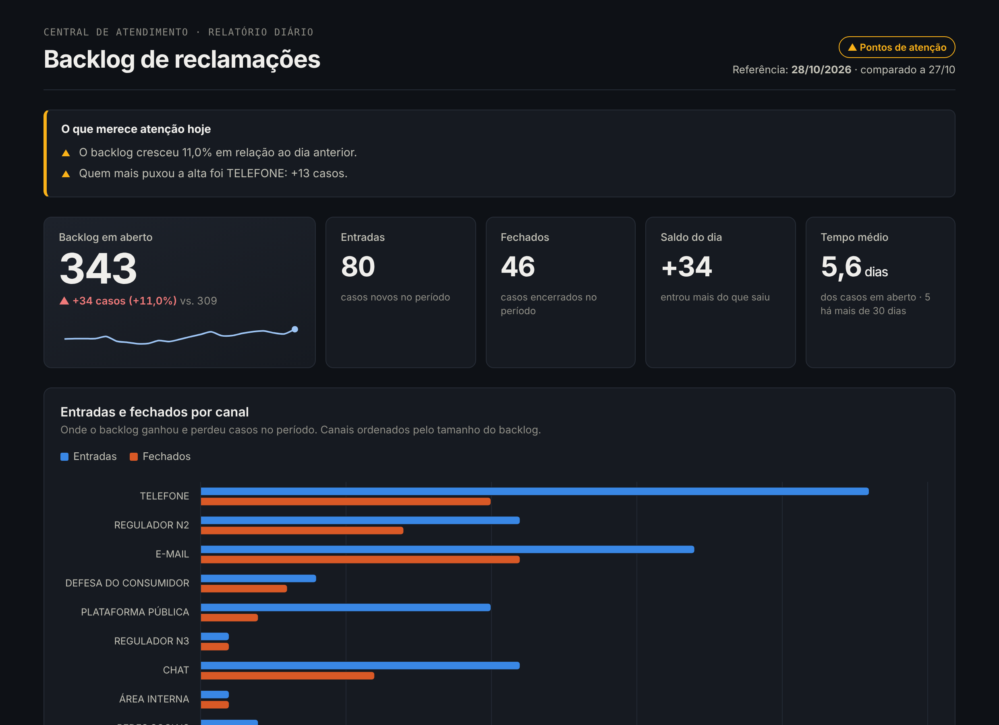
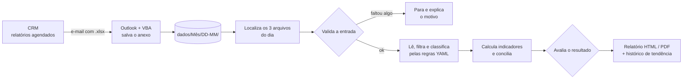

# 📊 Relatório de Backlog Automatizado

**Dos exports do CRM ao relatório executivo, sem nenhum passo manual.**

> ⏱️ **~1h30 por dia de trabalho manual eliminadas**: cerca de 30 horas por mês devolvidas à análise.

Todo dia uma central de atendimento precisa responder: *o backlog de reclamações cresceu ou caiu? Em qual canal? O que está envelhecendo?* Montar essa resposta à mão levava em média 1h30 diária: baixar planilhas, filtrar, cruzar dias, contar por canal e montar gráficos.

Este projeto automatiza o fluxo inteiro: os relatórios agendados chegam por e-mail, são salvos numa pasta organizada por data, e um pipeline em Python valida os dados, calcula os indicadores e gera um relatório HTML pronto para enviar à liderança.



> 🔎 [Ver o relatório completo](docs/img/relatorio_completo.png) · [abrir o HTML de exemplo](exemplo/relatorio_exemplo.html) (baixe e abra no navegador)

> **Sobre os dados:** esta é a versão pública de uma automação que construí e uso no trabalho. Todos os dados, nomes e regras deste repositório são **fictícios**. Os exports são gerados por um simulador incluído no projeto.

---

## Como funciona



Para cada dia, o pipeline usa três exports: **backlog de hoje**, **backlog do dia útil anterior** e **casos fechados**. A partir deles calcula:

| Indicador | Como |
|---|---|
| Backlog e variação | casos em aberto hoje × dia útil anterior, no total e por canal |
| Entradas | casos abertos entre os dois snapshots, incluindo os que entraram e saíram no mesmo dia |
| Fechados | casos encerrados no mesmo intervalo |
| Conciliação | `backlog anterior = backlog hoje − entradas + fechados`; se não fechar, o relatório avisa |
| Tempo em aberto (aging) | distribuição dos casos por faixa de dias aguardando e quantos passaram do limite crítico |
| Assuntos | top 10 em aberto, filtrável por canal |
| Tendência | entradas × fechados dos últimos dias, com backfill automático do histórico |

## Decisões de projeto

**1. Regras de negócio fora do código.** Que tipos de caso contam e como cada caso vira um canal ficam em [`config/regras.yaml`](config/regras.yaml). Quando a operação muda uma regra, edita-se uma linha de configuração, não o Python. A classificação aceita variações de escrita (`Call Center`, `CALL-CENTER`, `central telefônica`), porque export de CRM nunca é limpo.

**2. Validar antes de gerar, e poder recusar.** Um relatório errado enviado para a liderança custa mais do que um relatório atrasado. Se falta um arquivo, uma coluna sumiu ou o backlog veio vazio, o pipeline **para e explica o motivo** em vez de gerar números pela metade. É o primeiro degrau entre um script, que faz o que mandaram, e um agente, que confere e decide.

**3. Conciliação como teste de sanidade.** Os três exports precisam contar a mesma história. Se o backlog anterior real não bater com `hoje − entradas + fechados`, há caso reclassificado ou export incompleto, e o relatório sinaliza isso.

**4. Leitura tolerante ao formato do CRM.** O export traz um número variável de linhas de filtro antes da tabela. Em vez de fixar `header=15`, que quebra quando alguém muda um filtro, o leitor procura a linha do cabeçalho.

**5. Relatório que funciona offline.** O HTML embute a biblioteca de gráficos (Chart.js). Ele abre como anexo de e-mail, em rede corporativa restrita ou sem internet.

**6. Saída legível por máquina.** `--json` devolve status, alertas e métricas estruturados, pronto para outra automação, um envio por e-mail ou um agente de IA consumir.

## Como rodar

```bash
pip install -r requirements.txt

# 1. Gera 45 dias de exports fictícios em dados/
python scripts/gerar_dados_sinteticos.py --dias 45

# 2. Gera o relatório do último dia (e preenche a tendência)
python -m relatorio_backlog gerar

# Outras opções
python -m relatorio_backlog gerar --data 2026-10-28 --pdf   # dia específico + PDF
python -m relatorio_backlog gerar --json                    # saída estruturada
python -m relatorio_backlog backfill --dias 30              # só o histórico
```

Saída no terminal:

```
[ALERTA] Relatório de 28/10/2026
  ▲ O backlog cresceu 11,0% em relação ao dia anterior.
  ▲ Quem mais puxou a alta foi TELEFONE: +13 casos.
  → saida/relatorio_backlog_2026-10-28.html
```

Se faltar um arquivo:

```
[BLOQUEADO] Relatório de 28/10/2026
  ✗ Relatório de casos fechados de 28/10/2026 não encontrado.
```

Para gerar PDF: `pip install playwright && playwright install chromium`.

### Captura automática dos e-mails

[`integracoes/outlook/SalvarAnexos.bas`](integracoes/outlook/SalvarAnexos.bas) é uma macro para o Outlook desktop que salva os anexos dos relatórios agendados na estrutura `dados/<Mês>/<DD-MM>/` assim que o e-mail chega. Onde macros não são permitidas, o mesmo passo pode ser feito com Power Automate e OneDrive.

## Estrutura

```
config/regras.yaml             regras de negócio (filtros, canais, limites de alerta)
relatorio_backlog/
  leitura.py                   localiza os arquivos do dia e lê os exports
  regras.py                    carrega as regras e classifica canais
  metricas.py                  indicadores, conciliação, aging e assuntos
  validacao.py                 o que bloqueia, o que alerta, o que destacar
  historico.py                 histórico diário para a tendência
  pipeline.py                  orquestra tudo
  relatorio.py + templates/    HTML (Jinja2 + Chart.js embutido) e PDF
  __main__.py                  linha de comando
scripts/gerar_dados_sinteticos.py   simulador da central de atendimento
integracoes/outlook/            macro que salva os anexos
tests/                          21 testes (pytest), cobertura de 95%
```

## Testes

```bash
pip install -r requirements-dev.txt
pytest --cov=relatorio_backlog
```

Os testes cobrem a detecção de cabeçalho, a ordem das regras de canal, a matemática da conciliação, o bloqueio por arquivo ausente, o backfill sem duplicar e o fluxo completo da linha de comando. Rodam a cada push pelo GitHub Actions.

## Próximos passos

- [ ] Resumo em linguagem natural escrito por um LLM a partir do `--json`, revisado pelas mesmas regras de validação
- [ ] Envio automático do relatório por e-mail quando o status não for `BLOQUEADO`
- [ ] Agendamento diário (Agendador de Tarefas do Windows ou cron)

## Stack

`Python` `pandas` `openpyxl` `Jinja2` `Chart.js` `PyYAML` `pytest` `GitHub Actions` `VBA (Outlook)` `Playwright (PDF)`

---

Feito por [Gabriel de Oliveira Silva](https://github.com/GOS-briel) · [LinkedIn](https://www.linkedin.com/in/gabriel-de-oliveira-silva-39086b18b/)
